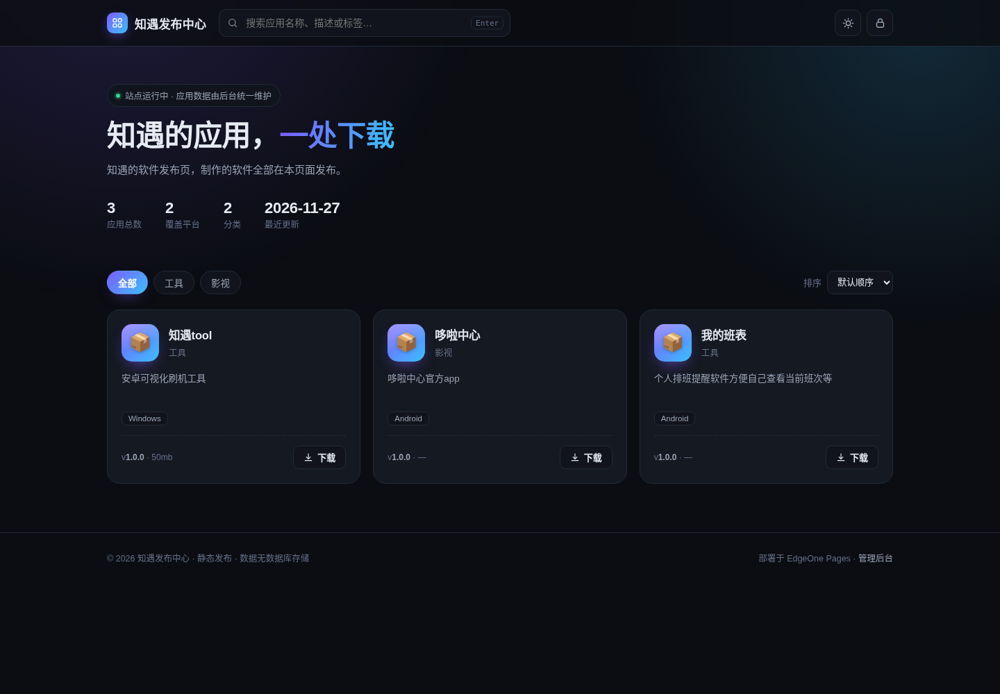
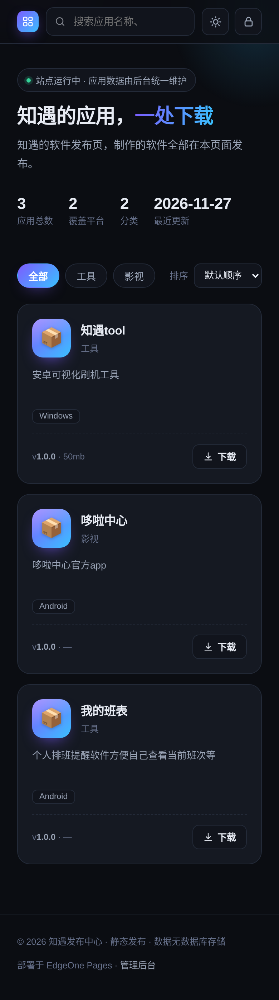
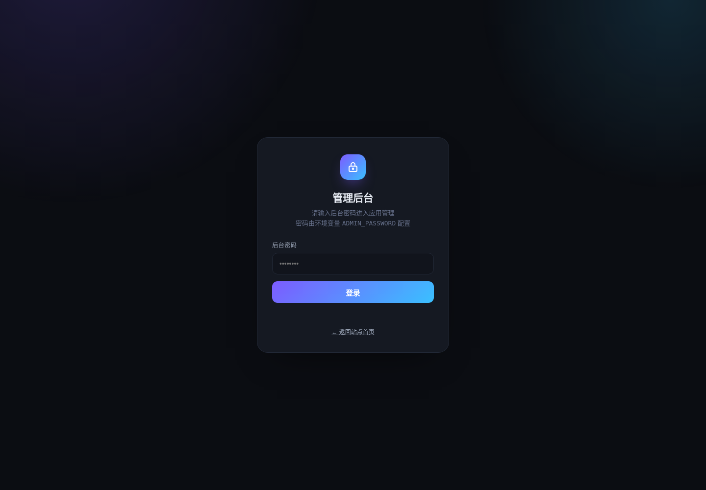

# 知遇发布中心 · App Hub

一个轻量的「应用发布页」：把散落各处的 App 集中到一页，统一版本、统一入口、统一更新。前台按分类筛选或直接搜索，后台输密码即可增删改，保存后**点一下「同步上线」**，前台刷新即时生效。

无服务器、无需自建数据库：托管在腾讯云 EdgeOne Makers（国际站），数据存在 EdgeOne Blob 存储里，后台密码只放环境变量。

线上示例：<https://app.466949.xyz>



## 特性

- **一页聚合**：卡片墙展示所有 App，图标、简介、平台标签、版本号、安装包大小一目了然
- **搜索 + 分类筛选 + 排序**：分类横向筛选，关键词即时搜索，可按名称 / 版本排序
- **真同步，不是本地草稿**：后台「同步上线」把整站数据写入云端 Blob，前台 `GET /api/data` 直接读，刷新即生效（强一致，不受 CDN 缓存影响）
- **后台密码登录**：密码只存环境变量 `ADMIN_PASSWORD`，代码里无明文；登录态是 12 小时 HttpOnly Cookie
- **站点信息可改**：站点名、浏览器标题、主标题两段、副标题、顶部小标签、页脚，全在后台编辑，不用改代码
- **手机自适应**：单列卡片、抽屉式筛选、表单单列，390px 宽度下不横向滚动
- **下载链接容错**：误带 `#`、漏写 `https://`、粘贴短链都能自动修正；没填链接时按钮灰显「待上传」
- **零打包依赖**：`build.sh` 只是把静态文件拷进 `dist`，部署一条命令

| 手机端 | 后台 |
| --- | --- |
|  |  |

## 架构

```
浏览器
 ├─ 前台 index.html ──► GET /api/data       (Node Function，读 Blob 存储)
 │                      ├► GET /api/apps    (Edge Function，读环境变量 APPS_JSON)
 │                      └► GET /data/apps.json（静态兜底）
 └─ 后台 admin.html ──► POST /api/login     (Edge Function，校验 ADMIN_PASSWORD → 下发 Cookie)
                        PUT  /api/data      (Node Function，校验 Cookie → 写 Blob)
```

数据读取优先级：**Blob 存储 → 环境变量 `APPS_JSON` → 静态 `data/apps.json`**。所以：

- 后台点过「同步上线」→ 以云端数据为准
- 从没点过 → 读 `APPS_JSON`（如果配了）
- 都没配 → 读仓库里的 `data/apps.json`，开箱即用

## 目录结构

```
apps-site/
├── index.html                 # 前台页面（样式、逻辑全部内联，无需打包）
├── admin.html                 # 后台页面（登录、列表、编辑弹窗、站点信息）
├── data/apps.json             # 初始种子数据（site 配置 + apps 数组）
├── functions/api/             # Edge Functions（轻量 JSON 接口）
│   ├── login.js               #   POST 登录 / GET 状态 / DELETE 退出
│   └── apps.js                #   GET 读取 APPS_JSON
├── node-functions/api/data.js # Node Functions（可带 npm 依赖，读写 Blob 存储）
├── package.json               # 唯一依赖：@edgeone/pages-blob
├── edgeone.json               # 缓存头：HTML 与 /data/* 不缓存，/api/* no-store
├── build.sh                   # 生成 dist 目录
├── docs/                      # README 截图
└── .env.example               # 环境变量模板
```

> `functions/`（Edge Functions）不能带 npm 依赖，所以读写 Blob 的接口放在 `node-functions/`；两者都会随静态文件一起部署。

## 本地预览

```bash
git clone https://github.com/banfeng-git/app-hub.git
cd app-hub
python3 -m http.server 8080     # 打开 http://localhost:8080
```

本地裸静态页会走 `data/apps.json` 兜底，能看到界面；登录和云端同步需要部署后才可用（本地没有 `/api/*`）。

## 部署到 EdgeOne Makers（国际站）

### 1. 安装 CLI 并登录

```bash
npm i -g edgeone           # CLI 1.7.x，命令仍是 edgeone makers（旧名 edgeone pages）
edgeone login --site global
```

会打印一个 device-login 链接，浏览器打开授权即可。**站点别选错**：中国站和国际站账号、域名体系完全不同，国际站部署要带 `--site global`（部署命令里对应 `-a overseas`）。

确认身份：

```bash
edgeone whoami
```

### 2. 建项目 + 配后台密码

在 <https://edgeone.tencentcloud.com> 控制台 Pages 里新建项目（或交给下一步部署时自动创建），然后设置密码：

```bash
edgeone makers env set ADMIN_PASSWORD '你的后台密码' -e production
```

密码只存在项目环境变量里，不进代码、不进仓库。改密码 = 重跑这条命令 + 重新部署，旧密码立即失效。

可选：只想要一份静态清单、不用后台的话，把整份 JSON 塞进变量也可以：

```bash
edgeone makers env set APPS_JSON '{"updated":"2026-11-27","apps":[...]}' -e production
```

### 3. 构建 + 部署

```bash
bash build.sh
edgeone makers deploy ./dist -n app-hub -a overseas
```

成功后返回 `https://<项目名>.edgeone.dev` 和控制台部署链接。

### 4. 默认域名只是 3 小时预览（重要）

免费版 `*.edgeone.dev` 是**限时预览**，直接访问会 401，响应头带 `X-EOP-MSG: eo_time missing`——不是配置错了。带 token 的预览链接形如：

```
https://app-hub.edgeone.dev/?eo_token=xxx&eo_time=xxx
```

要长期对外访问，去控制台给项目**绑定自定义域名**（示例站挂在 `app.466949.xyz`）。加速区域选「全球可用区（不含中国大陆）」时无需备案；要覆盖中国大陆节点则需备案。

### 5. Blob 存储

`node-functions/api/data.js` 用 `@edgeone/pages-blob` 的 `getStore("app-hub")` 打开存储空间，读写 key `data/site.json`，首次调用自动创建，不需要建表也不需要迁移脚本。

- 部署时 `package.json` 的依赖会被一起安装，`build.sh` 已把 `node-functions/` 拷进 `dist`
- 想换存储空间名，改 `node-functions/api/data.js` 里的 `"app-hub"` 即可
- EdgeOne Makers KV 目前是白名单内测（控制台「存储」页可能要申请），所以本项目用 Blob 而不用 KV

## 后台怎么用

1. 打开 `https://你的域名/admin.html`，输入 `ADMIN_PASSWORD`
2. 「站点信息」改站点名、标题、副标题、页脚 → 保存
3. 「应用列表」新增 / 编辑 / 删除，字段：名称、图标（emoji 或图片 URL）、简介、分类、平台、版本、大小、下载链接、是否推荐
4. 点 **同步上线**（快捷键 `Ctrl+S`）→ 写入云端，前台刷新即见

下载链接那栏直接粘贴就行：`#https://xxx` 会自动去掉 `#`，`xxx.com/a.apk` 会自动补 `https://`；留空则前台显示灰色「待上传」。

## 接口

| 方法 | 路径 | 说明 |
| --- | --- | --- |
| `POST` | `/api/login` | body `{"password":"..."}`，成功下发 `hub_admin` Cookie（HttpOnly / SameSite=Lax / 12h） |
| `GET` | `/api/login` | 返回 `{configured, authed, dataSource}` |
| `DELETE` | `/api/login` | 退出登录 |
| `GET` | `/api/apps` | 读环境变量 `APPS_JSON` |
| `GET` | `/api/data` | 读 Blob 里的整站数据（前台首选） |
| `PUT` | `/api/data` | 写整站数据，需 `hub_admin` Cookie |

登录 token：`sha256("apphub::login::v1::" + ADMIN_PASSWORD)` 取前 48 位十六进制。密码本身不下发、不落盘；改密码会让所有旧 Cookie 自动失效。

## 常见问题

**页面 401，`X-EOP-MSG: eo_time missing`** → 你在用免费默认域名直连。绑自定义域名，或用带 `eo_token` / `eo_time` 的预览链接。

**后台改了、前台没变** → 看后台右上角数据源：显示「云端存储（Blob）」说明同步成功，前台强刷即可；显示「本地草稿」说明还没点「同步上线」。

**点下载不跳转** → 老版本会把 `#https://…` 直接塞进 `href`，变成页内锚点。当前版本在保存时归一化、渲染时再兜一层，并给链接加了 `target="_blank" rel="noopener noreferrer"`。

**列表空空如也** → 后台可能把空数据同步上去了。点「同步上线」前有确认弹窗；真清空了，用 `data/apps.json` 再导入一次。

**换主题色** → 改 `index.html` 顶部的 CSS 变量 `--brand` / `--brand-2`，`build.sh` + 重新部署。

## 安全说明

- 后台密码只在环境变量里，仓库无任何凭据；`.env`、`dist/`、`.edgeone/` 已在 `.gitignore` 忽略
- 登录态是 HttpOnly Cookie，前端拿不到 token；写接口都校验 Cookie
- 这是「一密码管一站」的轻量方案，适合个人 / 小团队发自己的工具。要多人协作、分权限，建议换成带账号体系的后端

## License

[MIT](LICENSE)
